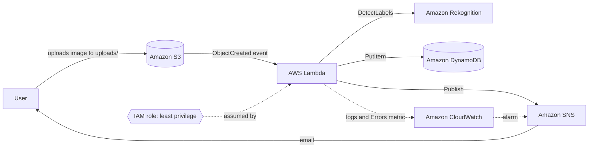

# Serverless Image Labeler on AWS

An event-driven image recognition pipeline built with **Amazon S3, AWS Lambda, Amazon Rekognition, Amazon DynamoDB, Amazon SNS, and Amazon CloudWatch**. Upload a photo and, within seconds, the objects detected in it (for example *Dog, Grass, Outdoors*) are stored with confidence scores and emailed to you. No servers to manage.

Built by Veronicah Maithya as a hands-on portfolio project for the AWS Cloud Practitioner / Cloud Foundations path.

## Architecture



*(Add your own diagram image from diagrams.net as `docs/09-architecture.png` and link it here.)*

## How it works

1. An image is uploaded to the `uploads/` prefix of the S3 bucket.
2. S3 sends an `ObjectCreated` event that invokes the Lambda function.
3. Lambda asks Rekognition to detect labels (up to 10, minimum 80% confidence).
4. The image name, labels, confidence scores, and timestamp are saved to DynamoDB.
5. Lambda publishes a summary to an SNS topic, which emails the subscriber.
6. A CloudWatch alarm emails the same topic if the function ever errors.

## AWS services and why they were chosen

| Service | Role in the project | Why |
|---|---|---|
| Amazon S3 | Stores uploaded images, triggers processing | Durable, cheap object storage with native event notifications |
| AWS Lambda | Runs the processing code | Serverless, pay only per invocation, scales automatically |
| Amazon Rekognition | Detects objects and scenes | Managed computer vision, no ML expertise or training needed |
| Amazon DynamoDB | Stores results | Serverless NoSQL with on-demand billing, no idle cost |
| Amazon SNS | Sends email notifications | Simple pub/sub for alerts |
| Amazon CloudWatch | Logs and error alarm | Monitoring and operational visibility |
| AWS IAM | Permissions | Least-privilege role for the function |

## Repository structure

```
.
├── lambda/lambda_function.py            # Lambda handler (Python 3.12)
├── iam/
│   ├── lambda-trust-policy.json         # Lets Lambda assume the role
│   ├── lambda-permissions-policy.json   # Least-privilege permissions (template)
│   └── s3-notification.json             # S3 -> Lambda trigger (template)
├── scripts/
│   ├── config.sh                        # Names and region
│   ├── deploy.sh                        # Builds everything with the AWS CLI
│   └── cleanup.sh                       # Deletes everything
├── docs/screenshots-checklist.md
├── sample-images/
└── README.md
```

## Prerequisites

- An AWS account with permission to create the resources above
- Use **AWS CloudShell** (the terminal icon in the console toolbar). It comes with the AWS CLI already authenticated, so there is nothing to install.
- A region where Amazon Rekognition is available. The default is `us-east-1`.
- A few `.jpg` or `.png` test images

## Step 0: Protect yourself from surprise charges

Do this before building anything.

1. Open **Billing and Cost Management > Budgets > Create budget**.
2. Choose **Zero spend budget** (or a **Monthly cost budget** of $1) and enter your email.
3. Open the **Free Tier** page in the billing console and check what your account includes.

This project uses a handful of images and pay-per-use services, so costs should stay at or near zero, but always confirm against your own account's free-tier terms.

## Deploy

1. Open CloudShell in the AWS console. Clone your repo:
   ```bash
   git clone https://github.com/<your-username>/aws-image-labeler.git
   cd aws-image-labeler
   ```
2. (Optional) Choose a different region:
   ```bash
   export AWS_REGION=eu-west-1
   ```
3. Set the email address for notifications:
   ```bash
   export NOTIFY_EMAIL=you@example.com
   ```
4. Run the deployment:
   ```bash
   bash scripts/deploy.sh
   ```
5. **Confirm the SNS subscription** by clicking the link in the email AWS sends you. Notifications will not arrive until you do.

The script creates the bucket, table, topic, log group, IAM role, Lambda function, S3 trigger, and CloudWatch alarm in that order, and prints progress for each step.

## Test it

Upload an image to CloudShell with **Actions > Upload file**, then:

```bash
source scripts/config.sh
aws s3 cp my-photo.jpg s3://$BUCKET/uploads/
sleep 10
aws dynamodb scan --table-name $TABLE
```

Expected: an item with the image key, a list of labels with confidence scores, and a timestamp. You should also receive an email summary.

To view logs:

```bash
aws logs tail /aws/lambda/$FUNCTION --since 10m
```

## Example output

```json
{
  "ImageKey": "uploads/my-photo.jpg",
  "LabelCount": 4,
  "Labels": [
    { "Name": "Dog", "Confidence": 99.12 },
    { "Name": "Pet", "Confidence": 99.12 },
    { "Name": "Grass", "Confidence": 95.4 },
    { "Name": "Outdoors", "Confidence": 91.7 }
  ],
  "ProcessedAt": "2026-11-05T10:15:30+00:00"
}
```

*(Replace with your real output and screenshots from `docs/`.)*

## Security design

- **Least-privilege IAM:** the Lambda role can only read objects under `uploads/` in this one bucket, call `DetectLabels`, write to this one table, publish to this one topic, and write to its own log group. Rekognition's `DetectLabels` does not support resource-level restriction, so it uses `*`.
- **S3 is private:** Block Public Access is enabled on the bucket.
- **Scoped invoke permission:** S3 can invoke the function only from this bucket and this account (`--source-arn` and `--source-account`), which prevents the confused-deputy problem.
- **No hardcoded credentials:** the function uses its execution role.
- **No recursive triggers:** the trigger fires only on `uploads/`, and the function writes results to DynamoDB rather than back to S3.

## Cost optimization

- Serverless services only: nothing runs or bills while idle.
- DynamoDB on-demand billing, so no provisioned capacity.
- CloudWatch log retention set to 7 days.
- Small test set, with a budget alert as a safety net.
- `cleanup.sh` removes every resource when the project is finished.

## Well-Architected Framework alignment

| Pillar | How this project addresses it |
|---|---|
| Security | Least-privilege IAM, private bucket, scoped invoke permission |
| Reliability | Managed, multi-AZ services; Lambda retries failed async invocations |
| Performance efficiency | Event-driven, scales automatically with uploads |
| Cost optimization | Pay-per-use services, short log retention, budget alert |
| Operational excellence | Infrastructure scripted and repeatable, logs and error alarm |
| Sustainability | No idle compute; resources deleted after use |

## Cleanup

Capture your screenshots first (see `docs/screenshots-checklist.md`), then:

```bash
bash scripts/cleanup.sh
```

This empties and deletes the bucket and deletes the function, table, topic, alarm, log group, and role.

## Troubleshooting

| Problem | Likely cause and fix |
|---|---|
| No DynamoDB item appears | Check logs: `aws logs tail /aws/lambda/$FUNCTION --since 10m`. Confirm the image went into `uploads/` and is a `.jpg`/`.png`. |
| `AccessDenied` in the logs | Role policy not applied or still propagating. Wait a minute and re-upload. |
| No email arrives | The SNS subscription was not confirmed. Check spam. |
| `BucketAlreadyExists` | Bucket names are global. Change `BUCKET` in `scripts/config.sh`. |
| `InvalidImageFormatException` | Rekognition accepts only JPEG and PNG. |
| Rekognition not available | Set `AWS_REGION` to a region that supports Rekognition. |
| A service is blocked or unavailable | Check your account plan and free-tier status in the billing console. |

## What I learned

*(Write 4-6 sentences in your own words. Ideas: how S3 events trigger Lambda, why Lambda needs an execution role, how least privilege works in practice, the difference between a resource policy and an identity policy, what you would do differently.)*

## Future improvements

- A static website on S3 with a presigned-URL upload form and a results page
- Add `DetectModerationLabels` or `DetectText`
- Use Amazon API Gateway to query results
- Rewrite the deployment as AWS CloudFormation or AWS SAM
- A dead-letter queue (SQS) for failed events
- Add AWS X-Ray tracing

## License

MIT
